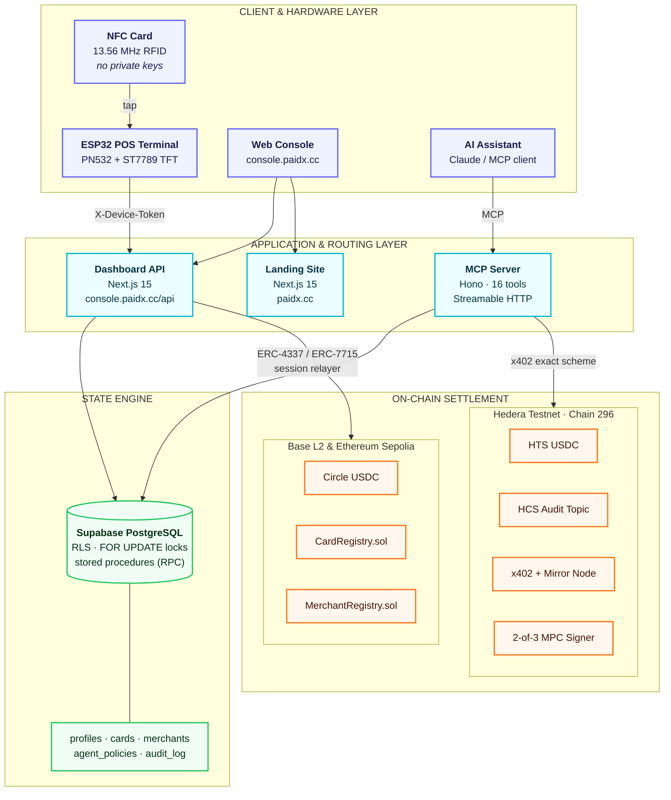
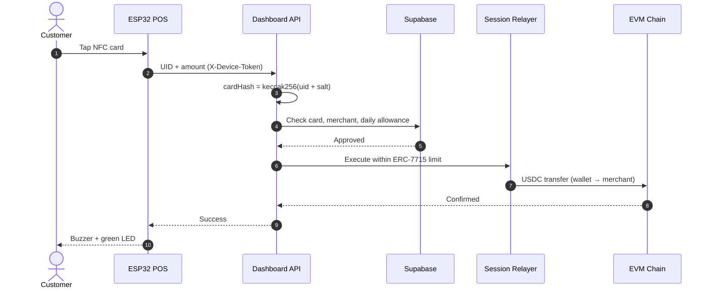
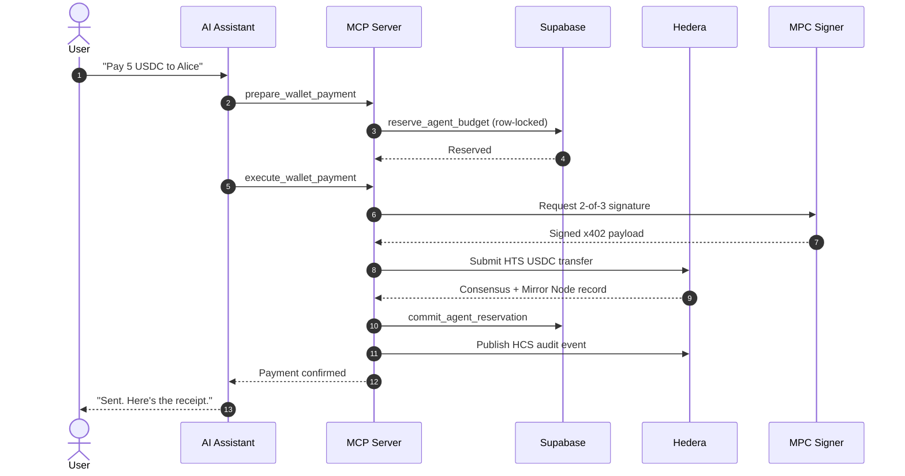

# PaidX
 
Non-custodial retail point-of-sale protocol and agentic commerce network bridging physical contactless NFC cards, hardware countertop terminals, EVM smart accounts, and AI-driven conversational payments.
 
---
 
## 1. System Overview
 
PaidX is a decentralized, non-custodial cryptocurrency payment infrastructure designed for physical economy retail transactions and autonomous AI commerce. It connects four core elements into a unified payment rail:
 
1. Physical Contactless NFC Cards: Unprivileged hardware cards that initiate instant payments without exposing private keys.
2. Hardware POS Terminals: Countertop ESP32-powered micro-terminals with RFID/NFC readers and color TFT touchscreens.
3. Smart Account Settlement: Scoped execution delegation and daily spending limits using ERC-4337 and ERC-7715 on Base L2 and Ethereum Sepolia.
4. Agentic Commerce Subsystem: A Model Context Protocol (MCP) server enabling AI assistants to execute conversational payments on Hedera Testnet using the Hedera x402 exact payment scheme and 2-of-3 MPC threshold signing.
### Core Principles
 
- Absolute Non-Custody: PaidX never holds custody of user or merchant funds. Payments settle atomically from the customer's self-custody wallet directly to the merchant's on-chain payout address.
- Scoped Delegation: Account ownership remains with the user. The user authorizes a backend Session Relayer or AI agent to execute transactions strictly within pre-approved daily rolling budget allowances.
- Cryptographic UID Privacy: Physical NFC cards contain zero private keys. The hardware UID is never stored or broadcast in plaintext; all contracts and databases reference salted cryptographic hashes:
  cardHash = keccak256(abi.encodePacked(rawCardUid, CARD_UID_SALT))
- On-Chain Verifiability: Every card tap, POS transaction, and agent payment produces verifiable on-chain events and Mirror Node records.
---
 
## 2. High-Level Architecture
 
PaidX is organized into four layers: hardware and clients at the edge, an application layer that routes requests, a state engine that enforces budgets atomically, and two settlement networks where funds actually move.
 

 
### Payment Flows
 
**Card tap at a countertop terminal (Base / Sepolia)**
 

 
**Conversational AI payment (Hedera)**
 

 
### Layer Responsibilities
 
| Layer | Components | Responsibility |
|---|---|---|
| **Client & Hardware** | NFC card, ESP32 POS, web console, AI assistant | Initiate payments; hold no keys and no funds |
| **Application & Routing** | Landing site, Dashboard API, MCP server | Authenticate devices, validate requests, orchestrate settlement |
| **State Engine** | Supabase PostgreSQL | Enforce budgets atomically, store policies, keep the audit trail |
| **On-Chain Settlement** | Base L2, Ethereum Sepolia, Hedera Testnet | Move funds directly from customer wallet to merchant, with verifiable events |
 
---
 
## 3. Subsystem Breakdown
 
### 3.1 Web Landing Page (`web/`)
 
Public marketing and waitlist application built with Next.js 15 (App Router), React 19, and Tailwind CSS.
 
- Hero Section: Interactive interactive checkout simulation with dynamic QR code generation.
- Real-Time Waitlist: Live subscriber registration connected to Supabase PostgreSQL with duplicate detection and dynamic counter.
- Interactive Showcase: Visual walkthroughs of the physical ESP32 terminal, smart account limits, and currency coverage.
- Design Language: Cohesive typography (Archivo), custom theme provider supporting Light and Dark modes, and standardized 8px border radii.
### 3.2 Merchant & User Console (`dashboard/`)
 
Full-stack decentralized application for customers, merchants, and protocol administrators.
 
- User Console (`/dashboard`):
  - Wallet balance display and native USDC deposit/withdrawal.
  - NFC card registration and hardware linking.
  - Daily spending allowance configuration (ERC-7715 scoped session limits).
  - Transaction history ledger with direct block explorer links.
- Agent Wallet & MPC Signing (`/dashboard/agents`):
  - Hedera Testnet wallet connection via MetaMask cryptographic challenge or native Account ID.
  - Genuine 2-of-3 Multi-Party Computation (MPC) threshold signing enrollment and key management.
  - Autonomous AI policy management: daily/monthly budgets, maximum per-transaction limits, and asset allowlists.
  - Natural language conversational payment interface with automated execution.
  - Interactive approval queue for payments exceeding autonomous limits.
- Merchant Portal (`/merchant`):
  - Merchant onboarding and settlement payout address registration.
  - Virtual Terminal (`/merchant/terminal`): Browser-based point-of-sale keypad for on-the-fly QR code generation.
  - POS Hardware Manager (`/merchant/pos`): Terminal provisioning, cryptographic token management, and live device telemetry.
- Protocol Administration (`/admin`):
  - On-chain merchant authorization and status management through `MerchantRegistry.sol`.
### 3.3 Smart Contracts (`contracts/`)
 
Solidity contracts compiled and tested using Foundry.
 
- `CardRegistry.sol`:
  - Registers salted card hashes linked to smart accounts.
  - Prevents plaintext UID leakage on-chain.
  - Owner-restricted card state management.
- `MerchantRegistry.sol`:
  - Maintains verified merchant metadata and payout destination addresses.
  - Admin-controlled authorization ensuring only approved retail merchants settle funds.
- `MockUSDC.sol`:
  - 6-decimal ERC-20 token simulating Circle USDC for testing and local development.
### 3.4 Hardware Countertop Terminal (`esp/`)
 
Embedded C++ firmware for standalone countertop hardware point-of-sale terminals.
 
- Hardware Platform: ESP32-WROOM-32 / ESP32-S3 microcontroller.
- Peripherals:
  - PN532 NFC/RFID module operating over I2C/SPI at 13.56 MHz.
  - ST7789 240x320 color TFT display.
  - Audio buzzer and status LEDs for instant payment confirmation.
- Firmware Architecture (`esp.ino`):
  - Secure Wi-Fi connectivity with automated reconnect loops.
  - Pre-shared Device Token authentication (`X-Device-Token`).
  - Sub-second tap-to-settle transaction pipeline.
  - On-screen PIN and amount entry for dynamic merchant requests.
### 3.5 Model Context Protocol Server (`mcp-server/`)
 
Standalone remote MCP server implementing the Anthropic Model Context Protocol specification via `StreamableHTTPServerTransport`.
 
- Standard Tools Exposed (16 Tools):
  - Wallet Tools: `get_connected_wallet`, `get_wallet_address`, `get_wallet_balance`, `get_supported_assets`, `get_supported_networks`.
  - Payment Tools: `prepare_wallet_payment`, `execute_wallet_payment`, `get_payment_status`, `get_transaction_details`, `get_payment_history`.
  - Policy Tools: `get_agent_permissions`, `get_agent_spending_limit`, `get_agent_spending_history`, `request_payment_approval`.
  - Diagnostics: `ping`, `echo`.
- Protocol Adherence:
  - Hedera x402 exact payment scheme with atomic unit calculations.
  - Row-locked budget reservation (`reserve_agent_budget` stored procedure).
  - Hedera Consensus Service (HCS) immutable audit event publishing.
### 3.6 Database & State Engine (`supabase/`)
 
PostgreSQL schema with row-level security and atomic transactional procedures.
 
- Tables: `profiles`, `merchants`, `pos_devices`, `cards`, `permissions`, `payments`, `wallets`, `agent_connections`, `agent_policies`, `agent_spending_reservations`, `agent_payments`, `hcs_audit_events`, `audit_log`, `waitlist_subscribers`.
- Stored Procedures:
  - `reserve_agent_budget`: Row-level locked (`FOR UPDATE`) reservation preventing concurrent double-spend race conditions.
  - `commit_agent_reservation`: Deducts confirmed payments from remaining budget allocations.
  - `release_agent_reservation`: Restores reserved allowances upon failed or rejected operations.
  - `get_waitlist_count`: Security Definer function returning total subscriber counts without exposing user emails.
---
 
## 4. Networks & Token Matrix
 
| Network | Chain ID | Primary Role | Currency / Asset | Contract / Asset ID |
|---|---|---|---|---|
| Base L2 | 8453 | Production Settlement | Native USDC | 0x833589fCD6eDb6E08f4c7C32D4f71b54bdA02913 |
| Ethereum Sepolia | 11155111 | Core POS Testnet | Circle Testnet USDC | 0x1c7D4B196Cb0C7B01d743Fbc6116a902379C7238 |
| Hedera Testnet | 296 | Agentic Commerce | HTS USDC | 0.0.5449156 |
| Hedera Testnet | 296 | Gas & Native Operations | Native HBAR | 0.0.0 |
 
---
 
## 5. Security & Cryptographic Guarantees
 
### Key Custody Boundaries
 
| Key / Secret | Storage Location | Scope & Usage | Risk Profile |
|---|---|---|---|
| User Private Key | Self-custody wallet (MetaMask) | Full control over user assets and permissions | Non-custodial; zero protocol risk |
| Admin Key | Admin MetaMask wallet | Owner of CardRegistry and MerchantRegistry | Browser-only signing; no server access |
| Session Relayer Key | Server environment variable | Submits card-tap transactions within daily caps | Contained to pre-authorized limits |
| MPC Key Shares | 2-of-3 threshold split (Client, Server, Recovery) | Signs agent payments autonomously | No single party can sign alone |
| Device Token | ESP32 Flash memory | Authenticates terminal requests to backend | Revocable per physical terminal |
| Supabase Secret Key | Server-only environment variable | Internal database orchestration | Restricted to backend API routes |
 
### Threat Mitigation Specifications
 
1. Card UID Replay Protection: Plaintext card UIDs are never accepted on-chain. Salted hashes prevent rainbow table attacks.
2. Atomic Budget Reservation: PostgreSQL `FOR UPDATE` row locks eliminate race conditions in multi-threaded agent execution environments.
3. Strict Decimal Arithmetic: BigInt-based conversion functions prevent IEEE 754 floating-point rounding errors during token calculations.
4. Hedera Consensus Service Auditing: Every conversational transaction writes a verifiable Base64 message to an immutable HCS topic.
5. Independent Verification: All transactions verify consensus via Hedera Mirror Node before local budget records are committed.
---
 
## 6. Repository Layout
 
```
PaidX/
├── brand/               # Brand guidelines, typography, and color tokens
├── contracts/           # Solidity smart contracts (Foundry framework)
│   ├── mock/            # Mock ERC-20 token contracts for local testing
│   ├── CardRegistry.sol # Salted card registration contract
│   └── MerchantRegistry.sol # Authorized merchant payout registry
├── dashboard/           # Next.js 15 Console application (console.paidx.cc)
│   ├── app/             # App Router pages (/dashboard, /merchant, /admin, /auth)
│   ├── components/      # UI components, navigation, and ThemeProvider
│   └── lib/             # Viem, Hedera SDK, MPC signer, and Supabase clients
├── docs/                # Architecture specifications, audits, and guides
├── esp/                 # ESP32 firmware source and hardware schematics
├── mcp-server/          # Standalone Model Context Protocol remote server
│   ├── api/             # Vercel serverless entry points
│   └── src/             # Transport layers, tool handlers, and policy logic
├── script/              # Foundry deployment scripts
├── sql-editor/          # Consolidated SQL schema migration scripts
├── supabase/            # Supabase configuration, migrations, and Edge functions
├── test/                # Unit, integration, and E2E automated test suites
└── web/                 # Next.js 15 Marketing & Landing page (paidx.cc)
    ├── app/             # Landing page App Router and waitlist API routes
    ├── components/      # Hero, features, interactive terminal demo, footer
    └── public/          # Optimized static assets, logos, and favicons
```
 
---
 
## 7. Prerequisites
 
Before setting up PaidX locally, ensure the following tools are installed:
 
- Node.js: Version 20.x or 22.x LTS
- Package Manager: npm version 10.x or pnpm version 9.x
- Foundry: `forge`, `cast`, and `anvil` for smart contract development
- Hardware Tooling (Optional): Arduino IDE or PlatformIO for ESP32 compilation
- Database: Supabase CLI or access to a hosted Supabase PostgreSQL project
---
 
## 8. Environment Setup
 
### 8.1 Landing Page (`web/.env.local`)
 
```env
NEXT_PUBLIC_SUPABASE_URL=https://your-project.supabase.co
NEXT_PUBLIC_SUPABASE_PUBLISHABLE_KEY=sb_publishable_your_key_here
SUPABASE_SECRET_KEY=sb_secret_your_key_here
```
 
### 8.2 Dashboard (`dashboard/.env.local`)
 
```env
# Application
NEXT_PUBLIC_APP_ENV=testnet
NEXT_PUBLIC_APP_URL=http://localhost:3000
NEXT_PUBLIC_SITE_URL=http://localhost:3001
 
# Ethereum Sepolia
NEXT_PUBLIC_CHAIN_ID=11155111
NEXT_PUBLIC_RPC_URL=https://rpc.sepolia.org
NEXT_PUBLIC_EXPLORER_URL=https://sepolia.etherscan.io
NEXT_PUBLIC_PAYMENT_TOKEN_ADDRESS=0x1c7D4B196Cb0C7B01d743Fbc6116a902379C7238
NEXT_PUBLIC_CARD_REGISTRY_ADDRESS=0x7cBD8DE77C16Ba79A1fe10E30913517845D68e51
NEXT_PUBLIC_MERCHANT_REGISTRY_ADDRESS=0xb11dAE79F1B187E95CB93655A983D6e86E574145
 
# Supabase
NEXT_PUBLIC_SUPABASE_URL=https://your-project.supabase.co
NEXT_PUBLIC_SUPABASE_PUBLISHABLE_KEY=sb_publishable_your_key_here
SUPABASE_SECRET_KEY=sb_secret_your_key_here
 
# Relayer & Salt
SESSION_ACCOUNT_PRIVATE_KEY=your_relayer_private_key_here
CARD_UID_SALT=your_secure_salt_hash_here
 
# Hedera Testnet
HEDERA_NETWORK=testnet
HEDERA_OPERATOR_ID=0.0.your_operator_id
HEDERA_OPERATOR_KEY=302e...your_operator_private_key
HEDERA_MIRROR_NODE_URL=https://testnet.mirrornode.hedera.com
HEDERA_TOPIC_ID=0.0.your_hcs_topic_id
HEDERA_USDC_TOKEN_ID=0.0.5449156
```
 
### 8.3 Hardware POS Terminal (`esp/paidx_secrets.h`)
 
Copy `esp/paidx_secrets.h.example` to `esp/paidx_secrets.h`:
 
```c
#define WIFI_SSID "Your_WiFi_SSID"
#define WIFI_PASS "Your_WiFi_Password"
#define PAIDX_API_URL "https://console.paidx.cc/api/payments"
#define PAIDX_DEVICE_ID "POS-ESP32-001"
#define PAIDX_DEVICE_TOKEN "psk_your_provisioned_device_token"
```
 
---
 
## 9. Quickstart Guide
 
### 1. Clone Repository & Install Root Dependencies
 
```bash
git clone https://github.com/RealRatnadwip/PaidX.git
cd PaidX
npm install
```
 
### 2. Start Marketing Landing Page
 
```bash
cd web
npm install
npm run dev
# Running on http://localhost:3001
```
 
### 3. Start Console Dashboard
 
```bash
cd ../dashboard
npm install
npm run dev
# Running on http://localhost:3000
```
 
### 4. Start Model Context Protocol Server
 
```bash
cd ../mcp-server
npm install
npm run build
npm start
# Running on http://localhost:3002/mcp
```
 
### 5. Build Smart Contracts
 
```bash
cd ..
forge build
forge test
```
 
---
 
## 10. Verification & Test Suite
 
The PaidX codebase incorporates automated test suites spanning unit, protocol compliance, and security regression checks.
 
### Running Test Suites
 
```bash
# Run contracts Foundry suite
forge test -vvv
 
# Run MCP server and Hedera x402 unit tests
cd dashboard
npm run test
 
# Run TypeScript typechecks across workspaces
npm run typecheck --prefix dashboard
npm run typecheck --prefix web
```
 
### Key Test Coverage Highlights
 
- `test/unit/mpc_autonomous_hedera_signing.test.ts`: Verifies 2-of-3 threshold signature reconstruction, invalid share rejection, and signature derivation.
- `test/unit/x402_and_facilitator.test.ts`: Validates atomic decimal conversions, facilitator communication, and payment payload structures.
- `test/unit/metamask_hedera_connection.test.ts`: Validates EVM-to-Hedera account resolution via Mirror Node.
- `test/unit/mcp_server.test.ts`: End-to-end tool call validation across all 16 MCP endpoints over streamable HTTP transport.
---
 
## 11. Production Deployment
 
### Vercel Deployment Settings
 
The repository is structured as a monorepo. When creating separate projects on Vercel:
 
1. Console Application:
   - Root Directory: `dashboard`
   - Framework Preset: Next.js
   - Environment Variables: Add variables from `dashboard/.env.local`.
2. Marketing Application:
   - Root Directory: `web`
   - Framework Preset: Next.js
   - Environment Variables: Add variables from `web/.env.local`.
3. Standalone MCP Server:
   - Root Directory: `mcp-server`
   - Framework Preset: Other / Node.js
   - Configuration: Driven by `mcp-server/vercel.json`.
---
 
## 12. Security Disclosure & Audit History
 
- Security Remediation: Completed November 6, 2026. Resolved key structure matching, facilitator validation, and stored procedure atomicity.
- Contract Ownership: Admin operations on `CardRegistry` and `MerchantRegistry` require hardware or browser wallet signatures from `0xA2e3A301159beA4429c56417aB0856a3f4569efa`.
- Database Policies: Public access is strictly denied across sensitive tables. Read access to aggregate statistics is granted exclusively through Security Definer functions.
For technical inquiries or vulnerability reports, review the comprehensive reports located in the `/docs` directory.

---

## 13. Official Links & Community

- GitHub Repository: [https://github.com/RealRatnadwip/PaidX](https://github.com/RealRatnadwip/PaidX)
- Official X (formerly Twitter): [https://x.com/paidx_cc](https://x.com/paidx_cc)
- Documentation: [https://paidx.cc/docs](https://paidx.cc/docs)
- Console: [https://console.paidx.cc](https://console.paidx.cc)
